<div align="center">
  <h1>Mathesis</h1>
  <p><b>智学数研 · 数学垂类大模型 · 面向高中数学的三端 AI 教学平台</b></p>
  <p>学生端接管「学到会」，教师端接管「备得完」，科研端接管「读得懂、写得顺」。</p>
  <p><i>Mathesis（μάθησις）—— 希腊语「学习的行为」，也是 mathematics 一词的词根。</i></p>
</div>

<div align="center">
  
  
  
  
  
  <a href="https://github.com/xu123hu/mathesis/actions/workflows/ci.yml"></a>
  
</div>

<p align="center">
  <a href="#-这不是又一个数学聊天框">差异化</a> ·
  <a href="#-界面实录">界面实录</a> ·
  <a href="#-快速开始">快速开始</a> ·
  <a href="#-系统架构">系统架构</a> ·
  <a href="#-它背后是真实数据">真实数据</a>
</p>

<p align="center">
  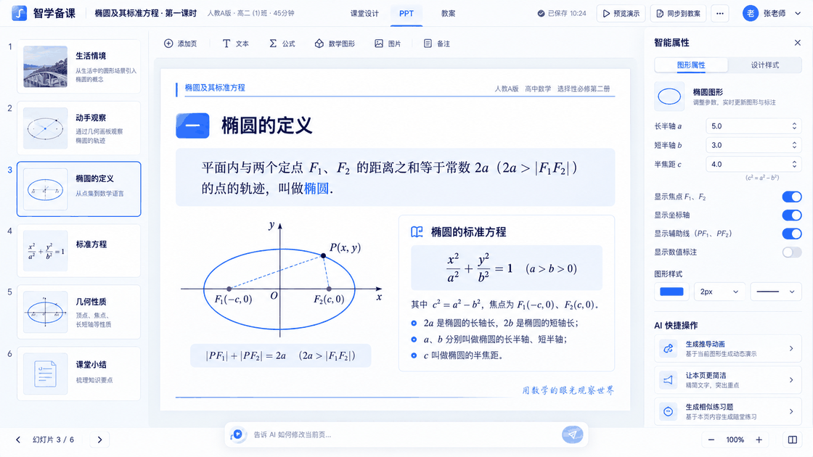
</p>

> 上图不是模板演示 —— 左侧缩略栏、右侧参数面板、画布上被重绘的椭圆与坐标轴，都是真实产品里跑出来的界面。

## 🎯 这不是又一个数学聊天框

PhotoMath 和作业帮到「你看到答案」就结束了。Mathesis 的终点是「你下次会做」。

| 端 | 一句话价值 |
|---|---|
| 🎓 **学生端** | AI 不报答案，先诊断卡点、推变式、排复习；FSRS 把遗忘曲线变成复习计划 |
| 👩‍🏫 **教师端** | 教学设计 → PPT → 教案**真产出文件**：PPT 内核参数化可调，一致性检查真比对，导出可用的 PPTX |
| 🔬 **科研端** | 读、写、验在同一个项目里发生：PDF 选中即问 Agent，LaTeX 边写边编译预览，公式可校验 |
| 🧠 **知识地基** | 52 个知识点编码 × 12 模块，5,689 道题、10,545 个知识片段，全部垂直于高中数学 |
| 🔒 **自持部署** | Docker Compose 全栈私有化，SymPy 沙箱算数学，MinIO 存文件，数据不出域 |

三个身份三套真实工作区，**不是同一套聊天 UI 套三个皮肤**。

## 🖥️ 界面实录

以下每张图都来自端到端验收脚本的真实运行输出（截图溯源与复跑方式见 [docs/audits/2026-10-21-migration-completeness-audit.md](docs/audits/2026-10-21-migration-completeness-audit.md)）。

### 🎓 学生端 · 对话式学习与可视化讲解

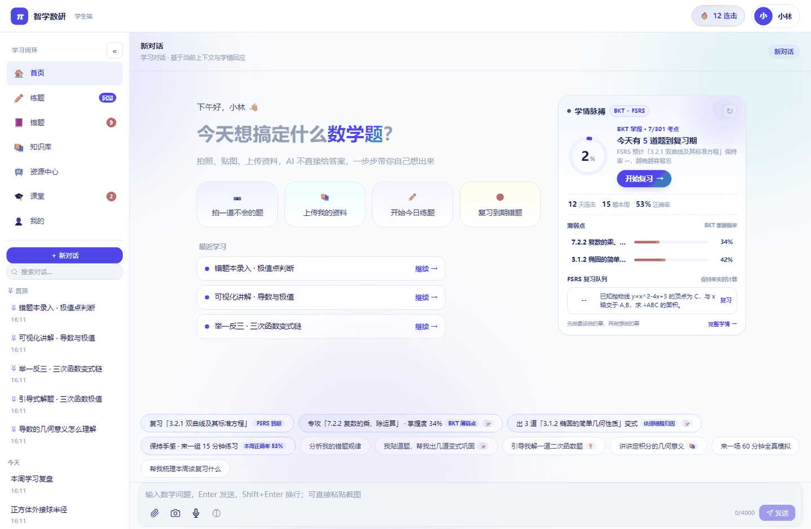

> 单入口对话即学习流。右侧「学情脉搏」不是装饰卡片 —— BKT 掌握度与 FSRS 复习队列来自真实的学生作答记录。

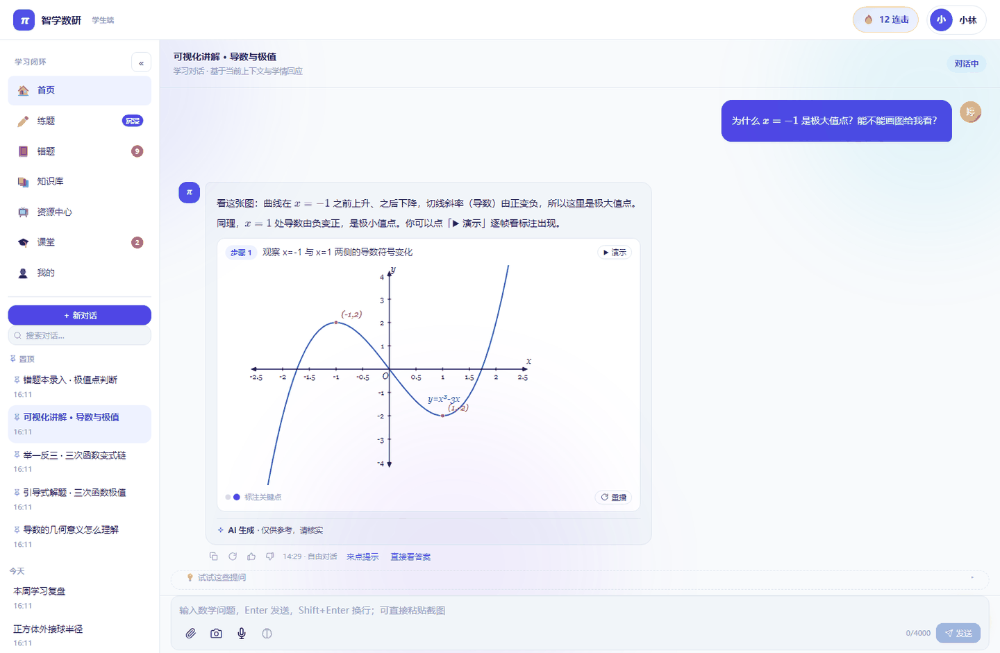

> AI 判断「x = −1 是极大值点」这类结论需要图形支撑时，直接生成可交互坐标系曲线图，而不是给一段静态答案。

**举一反三的变式链**：AI 给出变式题后会自行判定你是否掌握，未通过则自动推下一题。

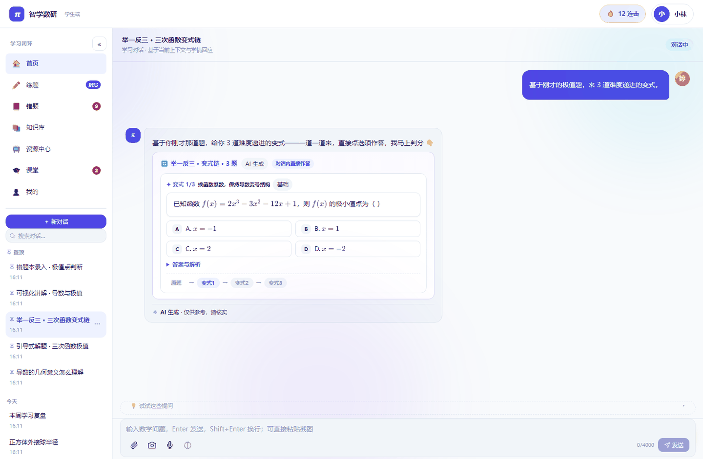

### 🎓 学生端 · 错题本与 FSRS 复习

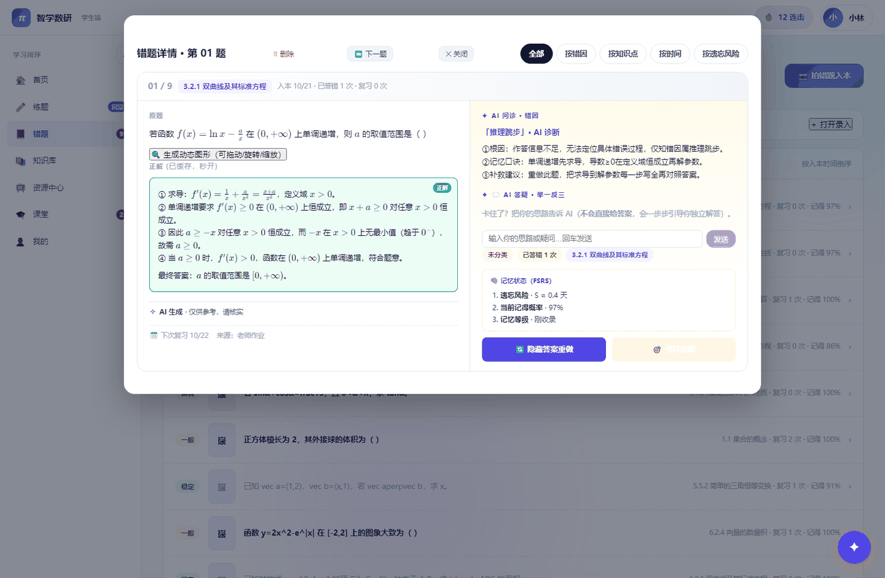

> 错题本不是「抄一遍」。每道错题配 AI 追问定位错因、贴上知识点编码，并按 FSRS 记忆状态给出遗忘风险与下次复习时间。

### 👩‍🏫 教师端 · 备-教-批-评闭环

**课堂设计**：AI 生成六环节教学流程（生活情境 4min → 动手观察 8min → 椭圆的定义 8min → 从定义到标准方程 12min → 数形结合+变式 9min → 课堂小结 4min），每环节带教师提问、学生活动、板书要点，并附教材页码与教学要求。

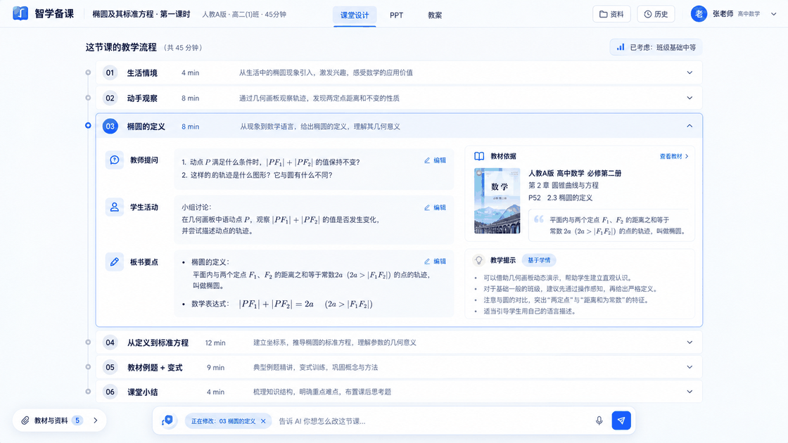

**教案**：完整教学目标 / 重难点 / 逐环节教学过程表（环节·时长·教师活动·学生活动·设计意图）/ 板书设计 / 作业布置 / 教学反思。

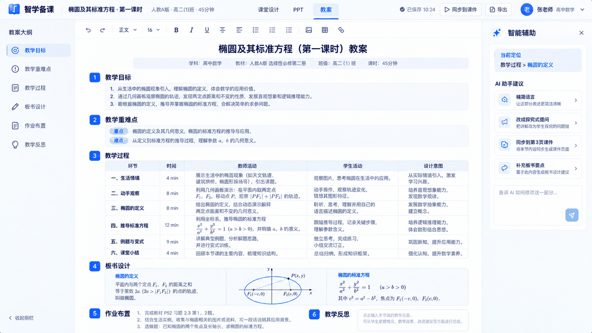

**作业与批改**：按班级 + 知识点组选题组卷，学生提交后进入 AI 批改队列，批改结果直接回传学生。

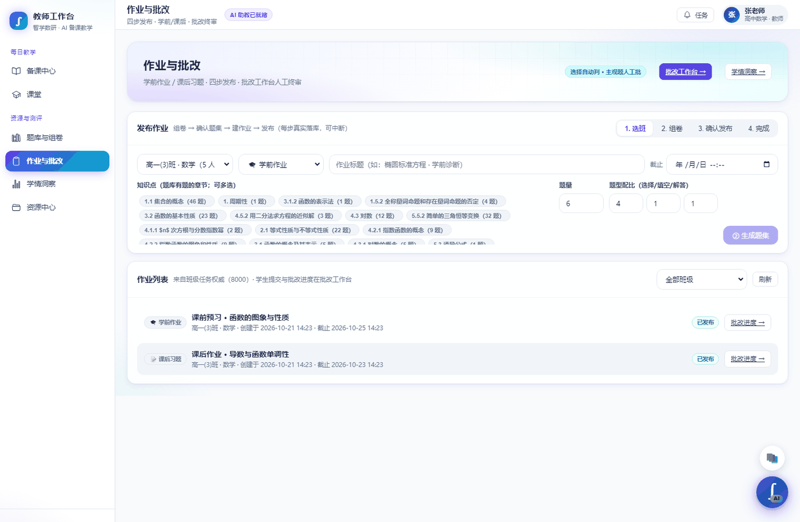

**双师课堂的跨端联动**：教师建班发邀请码 → 学生入班 → 教师发布作业 → 学生提交 → AI 批改 → 学情回流教师端。下面是这条链路上两个真实节点。

<p>
  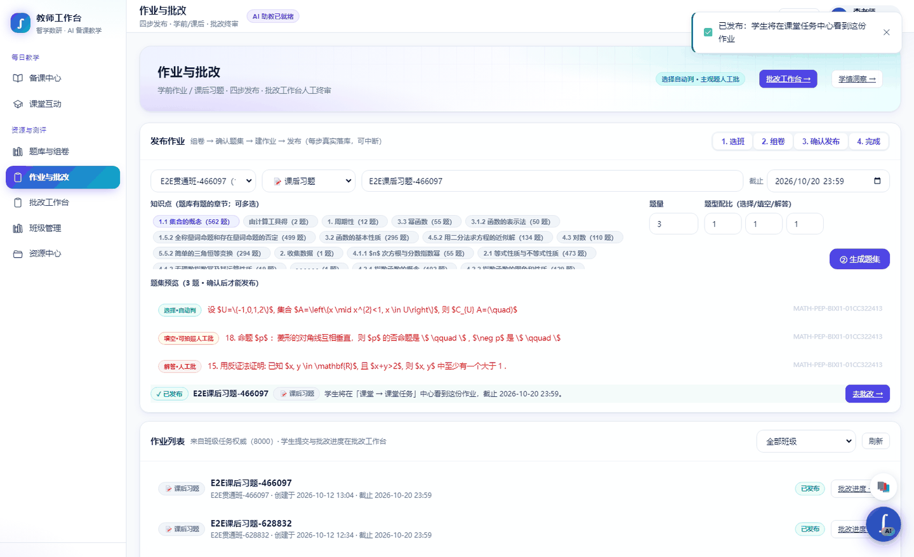
  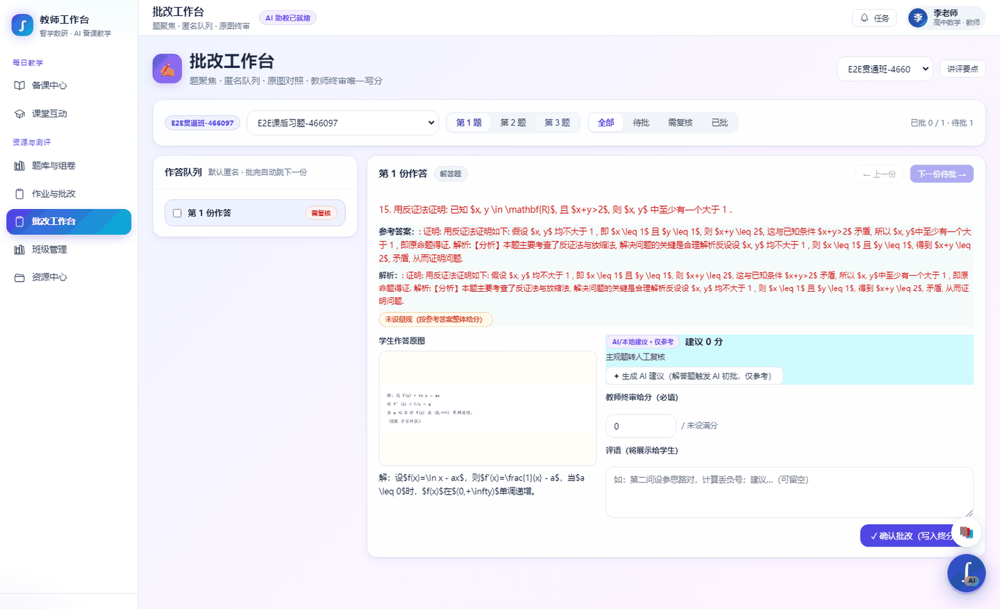
</p>

> 完整的 24 张全流程证据链在 `deliverables/two-end-link/evidence/`，由 `frontend/e2e/two-end-link-acceptance.mjs` 生成 —— 每张图都能复跑再生。

### 🔬 科研端 · READ / WRITE 双工作区

**READ 工作区**：左侧文献库，中间 PDF 精读（可划词、可复制公式），右侧 Research Agent 基于选中内容给出推导检验 —— 关键信息标「与子结论一致」或「与子结论冲突」并附判断依据与引用溯源（如 Céa 1971, p.287）。

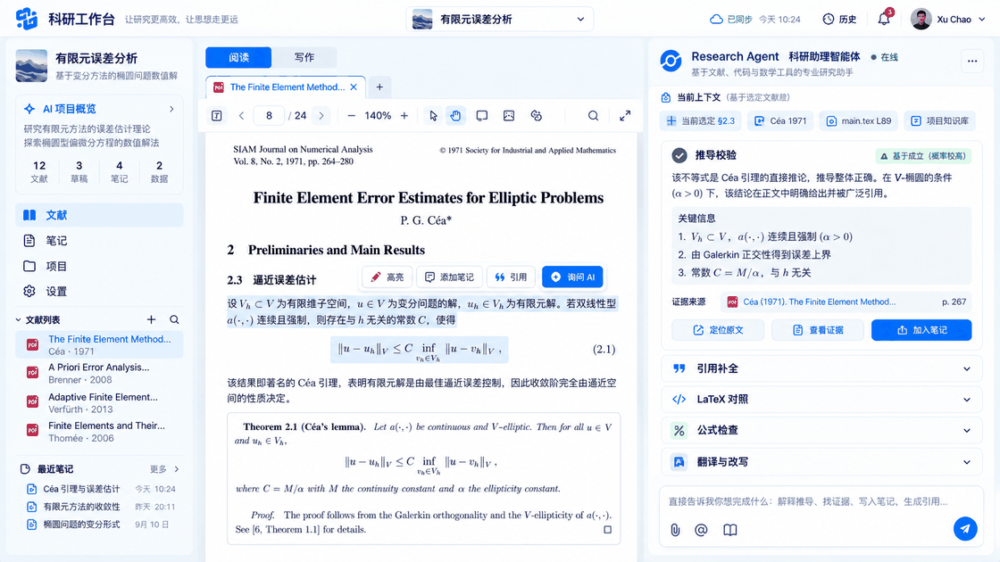

> 「与子结论冲突」是普通 RAG 工具不会做的事 —— 它在做**逻辑校验**，而不只是语义检索。

**WRITE 工作区**：LaTeX 编辑器 + 实时编译预览 + 编译日志同屏（29.4s 编译完成，日志里有真实的 undefined references 警告），右侧 Research Agent 提供润色、引用补全、翻译与改写。

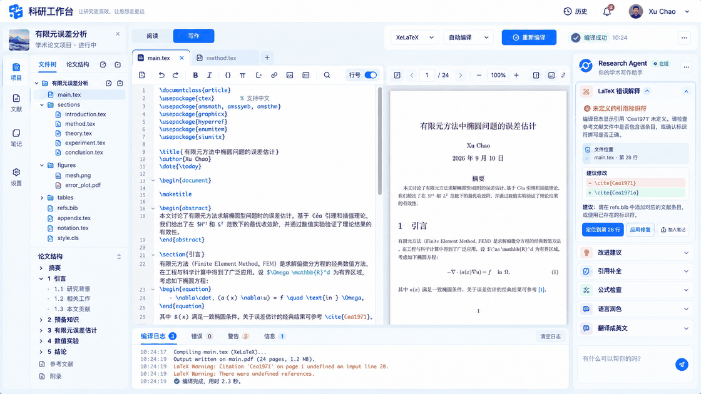

> 编译日志里真实的 warning 让这张图更可信 —— 它是真跑出来的，不是截图摆拍。

## 🚀 快速开始

> **前置**：Docker 24+、Python 3.11+、Node 20+、pnpm 9+。LLM API Key 需自备（DeepSeek-V4 / 豆包 Seed / Qwen VL 任选其一）。

<details open>
<summary><b>方式一：Makefile 一键（推荐）</b></summary>

```bash
git clone https://github.com/xu123hu/mathesis.git
cd mathesis
cp .env.example .env        # 填入 SPARK_API_PASSWORD 与 EMBEDDING_API_KEY
make setup                 # 启动 Docker 基础设施 + 数据库迁移
make api                   # 后端 API  → http://localhost:8000/api/health
make frontend              # 学生端   → http://localhost:5176
make seed                  # 灌入演示数据（可选）
```

</details>

<details>
<summary><b>方式二：手动分步</b></summary>

```bash
# 1. 基础设施：PostgreSQL(×2) / Redis / Valkey / MinIO，自动创建 4 个数据库
docker compose -f deploy/docker-compose.yml up -d
docker compose -f deploy/docker-compose.yml ps

# 2. 后端 API
cd services/api
python -m venv .venv
.venv/Scripts/activate        # Windows
# source .venv/bin/activate   # macOS/Linux
pip install -e ".[dev]"
alembic upgrade head
python run_server.py          # → http://localhost:8000/api/health

# 3. 前端
cd frontend
cp .env.example .env
pnpm install
pnpm dev                      # → http://localhost:5176
```

> 教师平台、科研工作台、PPT 生成需各自单独迁移：`make migrate-teacher` / `make migrate-research`。

</details>

**端口速查**

| 服务 | 端口 | 数据库 |
|---|---|---|
| PostgreSQL (pgvector pg15) | 54329 | math_arena, research_vnext |
| PostgreSQL (pgvector pg16) | 54330 | teacher_platform, ppt_studio_v2 |
| Redis | 6379 | 主缓存 |
| Valkey | 6380 | 教师平台 |
| MinIO | 9000 / 9001 | 文件存储 |
| 后端 API | 8000 | — |
| 学生端前端 | 5176 | — |
| 教师平台 / PPT / 科研 | 8100 / 8200 / 8300 | — |

<details>
<summary><b>🔑 演示账号（免注册，点开即用）</b></summary>

| 身份 | 手机号 | 密码 |
|---|---|---|
| 学生 | 13800001001 | `MathArenaDemo2026!` |
| 教师 | 13800001002 | `MathArenaDemo2026!` |
| 科研 | 13800001003 | `MathArenaDemo2026!` |

由 `python tools/seed_demo_accounts.py --profile local` 灌入。

</details>

## 🏗️ 系统架构

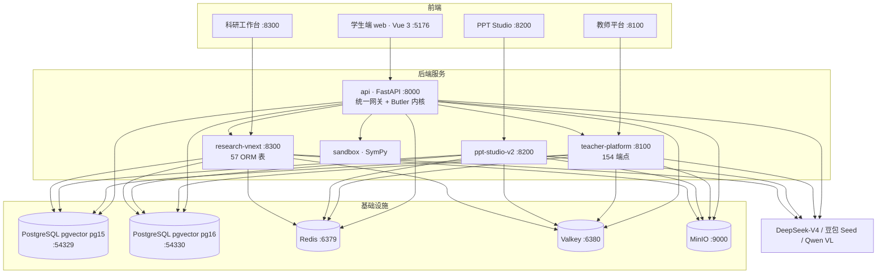

| 层 | 技术 |
|---|---|
| 前端 | Vue 3 + TypeScript + Vite + Pinia + Naive UI + KaTeX + JSXGraph + Three.js |
| 后端 | FastAPI + SQLAlchemy 2.x (async) + Pydantic v2 + Alembic |
| 数据库 | PostgreSQL 15/16 + pgvector（4 库 42/18/19 个迁移） |
| 缓存 | Redis 7 / Valkey |
| AI | DeepSeek-V4 + 豆包 Seed + Qwen VL（可插拔多通道 + 熔断降级） |
| 数学执行 | SymPy 沙箱 |
| 部署 | Docker Compose |

<details>
<summary><b>仓库结构</b></summary>

```
mathesis/
├── frontend/                  # Vue 3 三端统一前端（src/test/e2e/scripts）
├── services/
│   ├── api/                   # FastAPI 统一网关 :8000
│   ├── teacher-platform/      # 教师备课中心 :8100
│   ├── research-vnext/        # 科研工作台 :8300
│   ├── ppt-studio-v2/         # PPT 生成 :8200
│   ├── ppt-presenton/         # PPT 渲染适配
│   └── sandbox/               # SymPy 沙箱
├── packages/protocol/         # 前后端共享类型
├── deploy/                    # Docker Compose + Nginx + init-db
├── docs/                      # 产品契约 / Golden / 审计报告
├── data/                      # 知识库种子 / 论文种子
├── tools/                     # 播种 / README 资产生成
└── .github/workflows/         # CI
```

</details>

## 📊 它背后是真实数据

| 数据 | 规模 | 说明 |
|---|---|---|
| 题库 `question_bank` | **5,689** 道 | 含高考真题 905 道（已重标难度） |
| 知识点 `knowledge_points` | **52** 个 | 覆盖 12 个模块，全链路共用同一套编码 |
| 知识库 `chunks` | **10,545** 个 | 来自知识文档的向量化片段 |
| 用户 | **9,013** 个 | 错题记录 530 条 |

> 数据来源：`docs/后端现状审计报告.md`。所有错题、掌握度、变式推荐、复习排期共用同一套知识点编码 —— 这是通用 LLM 套壳做不到的事。

## 📚 文档与治理

| 文档 | 内容 |
|---|---|
| [AGENTS.md](AGENTS.md) | 仓库级工程规则（Brownfield-first、能力映射、Golden 协议） |
| [docs/research-workspace/](docs/research-workspace/) | 科研端产品契约 + READ/WRITE 黄金图（单一视觉真源） |
| [docs/product/teacher-prep-center/](docs/product/teacher-prep-center/) | 教师端备课中心产品契约 + 3 张黄金图 |
| [docs/design/GOLDEN_OBSERVATION_*.md](docs/design/) | 8 份逐页视觉观察记录（每张 Golden 的 MUST HAVE / MUST NOT HAVE 明细） |
| [docs/audits/](docs/audits/) | 工程审计与迁移完整性审计 |

**已知限制**（诚实清单，避免踩坑）：

- 教师平台、科研工作台、PPT 生成三个服务需各自单独跑数据库迁移（`make migrate-teacher` / `make migrate-research`），`make migrate` 只覆盖主库。
- `rapidocr_onnxruntime`（拍照识题）在 Python 3.13 上暂无发行版，请使用 3.11/3.12。
- README 中的界面截图来自验收脚本的历史运行输出，仓库当前不随代码分发运行期数据库。
- CI 徽章为占位状态，protocol-check 依赖根 workspace 的 `pnpm install`。

## 📄 License

Private. 保留所有权利。
