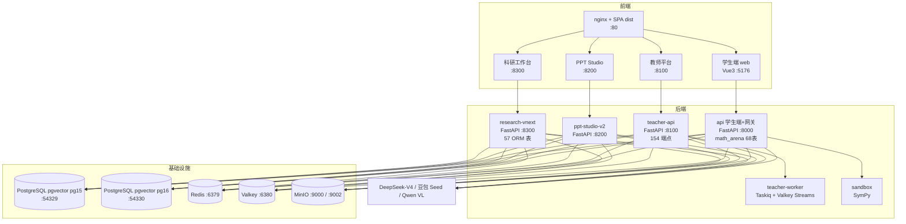

# ZXSY Math Arena · README 重写方案与内容素材包

> 日期：2026-10-21（v2，同日修订）
> 作者：Alice（产品经理）
> 定位：本文件是**方案 + 文案素材**，不是最终 README。最终 README 由工程师在���方案基础上落笔。
> 约束遵守情况：所有截图路径均已用 `ls` / `find` / `Read` 亲自验证存在；未验证的一律标注为「缺口」；未修改 `README.md` 本体。

> ### ⚠️ v2 修订摘要（经与 software-architect 交叉验证后修正，3 处实质性更正）
>
> | # | v1 的说法 | v2 修正为 | 验证方式 |
> |---|---|---|---|
> | **C-1** | 主选用 `demo-seed-verify-141` 批次（"更晚"） | **改用 `demo-seed-verify-141`**。141 才是最新批次（mtime 16:46:10–16:46:54 vs 162 的 16:45:13–16:45:59）。且 **162 的 `05-errors.png` 有 LaTeX 渲染回归**（裸露 `\frac{1}{x}+\frac{a}{x^2}` 源码），141 渲染正常 | `ls --time-style` 逐图 mtime + 逐图 md5 + 两张图 `Read` 目视对读 |
> | **C-2** | Golden 压到 ≤400KB（PNG 量化路线） | **改用 WebP 路线**。PNG 量化实测无法达标（1440/256色 = 635KB）；**WebP 1440/q90 = 95–151KB，5 张合计 644KB（原 PNG 7129KB，压缩 91%）**，且数学公式笔画经放大目视仍完全锐利 | PIL 实测 12 组参数 + 公式区放大目视比对 |
> | **C-3** | 架构图"需工程师用 mermaid 生成"（骨架基于泛化描述） | **骨架改以 `deploy/docker-compose.yml` + `Makefile` 实测为准**，不转 `architecture-handbook` HTML（该手册 0 个 `<svg>`/0 个 ``/0 个 mermaid 块，且其「api 141 文件」已过时，实测 202 文件） | 架构师三重验证 + 本人核对 `docs/` 0 个 mermaid |
>
> 另新增：v1 提出的 `docs/readme/` 搬运已由 `tools/prepare_readme_assets.py` **实际落地**（17 张产物，且其 `OLD` 常量已正确指向 141 批次）—— v1 缺口 G-3 事实上已闭环。

---

## 0. 现状诊断（为什么现在要重写）

现有 `README.md` 全文仅 3736 字节，纯文字速查表，存在 5 个硬伤：

| 问题 | 证据 | 后果 |
|---|---|---|
| **无视觉** | 全文 0 张图片、0 个 badge、0 个 emoji 分区 | 首屏无锚点，读者 3 秒内无法判断"这是什么" |
| **无差异化** | 首屏只有一句"数学垂类大模型 —— 面向高中数学的三端 AI 教学平台" | 与 PhotoMath / 作业帮 / NotebookLM 无法区分，淹没在同类项目里 |
| **功能是清单不是故事** | 3 行 bullet 罗列三端功能 | 只说了"有什么"，没说"凭什么不一样" |
| **技术栈淹没在安装步骤后** | 技术栈表在第 111 行 | 开发者关心技术选型，却要滚过 100 行才能看到 |
| **无验收证据** | 无任何截图 | 全部承诺靠自述，无视觉证据支撑 |

**结论**：当前 README 是"能跑起来的说明书"，缺一个"能让人相信的产品主页"。重写目标 = **先卖价值，再给证据，最后给上手**。

---

## 1. 开源 README 范式调研清单（14 个真实项目，均已实际访问）

> 说明：以下 URL 均为实际访问过的仓库首页（部分 404 已剔除，如 `samvera/samvera`、`ljw1412/ChatGPT`、`littlefei/ChatGPT-on-WeChat`、`chenzomi12/AIWrite`、`tyzbit/BiLearn` 返回 404，未纳入）。

### 1.1 AI / Agent 平台类

| # | 项目 | URL | 提炼出的可迁移做法 |
|---|---|---|---|
| 1 | **Dify** | https://github.com/langgenius/dify | ① 顶部静态封面图作 hero，紧跟 4 个链接行（Cloud / Self-hosting / Documentation / Edition overview）当导航；② `## Key features` 用 **7 条加粗编号段落**（`**1. Workflow**: ...`）而非表格，扫读极快；③ `## Quick start` 用 **blockquote 写系统要求**（CPU/RAM）+ 代码块 + 访问地址，结构极紧凑；④ 部署选项用 3 个加粗标签段落（Cloud / Community / Enterprise）做"卡片感"而非表格；⑤ `### Contributors` 放贡献者头像网络图；⑥ `## Star History` 同时给浅色/深色两版（`#gh-light-mode-only` / `#gh-dark-mode-only`）；⑦ **没有显式 TOC**，靠 heading anchor 隐式导航 —— 对我们同样成立（README 不长时 TOC 是浪费） |
| 2 | **Open WebUI** | https://github.com/open-webui/open-webui | ① Hero 定位句"**a home for AI**"极短且有力；② badge 分两类：仓库指标（stars/forks/watchers/last commit）+ 社区/赞助（Discord/Sponsor）；③ **Hero 之后紧跟一张 `demo.png`**，不设独立 Screenshots 章节 —— 首屏即见产品真容；④ `## Key Features of Open WebUI ⭐` 用 **emoji 项目符号**（🚀🤝🔐🧩…）替代表格；⑤ `## How to Install 🚀` 下用四级标题切分 pip / Docker 默认 / CUDA / 仅 API 多种场景；⑥ `## Security 🛡️` 独立成节，明确"只接受 GitHub 私下报告"；⑦ 结尾 `## License 📜` 说明多许可证结构并链 `LICENSE` / `LICENSE_HISTORY` / `LICENSE_NOTICE` |
| 3 | **LangChain** | https://github.com/langchain-ai/langchain | ① 一句品牌口号当 H2（`### The agent engineering platform.`）；② badge 聚焦 **许可证 / 下载量 / 版本** 三个决策因子；③ **`## Why use LangChain?`** 六条加粗短语式卖点，每条先讲用户价值再讲实现；④ `## LangChain ecosystem` 按"开发者工作流"而非"功能"分组（构建→编排→接入→调试→部署）；⑤ Quickstart 给**最小可运行 5 行代码**而非框架全貌；⑥ `## Resources` 汇总 Documentation / Discussions / Contributing / Code of Conduct |
| 4 | **n8n** | https://github.com/n8n-io/n8n | ① H1 直接是**价值主张 + 品类**："n8n – The Platform for AI Agents and Workflow Automation"；② 首屏一个数字建立规模感："1500+ integrations"；③ `## Key Capabilities` 六条，格式统一为 `- **能力名**: 一句价值说明`；④ **不贴截图而是贴"示例库"链接**（Example Workflows）—— 我们可类比"贴真实验收截图 + 演示账号"；⑤ `## What does n8n mean?` 这种"名字来历"小节增加人格感 |
| 5 | **Claude Code** | https://github.com/anthropics/claude-code | ① 一段话讲清"是什么 + 在哪跑 + 能干什么 + 怎么用"（终端/IDE/GitHub @）；② **安装按平台分行加粗标注推荐项**（MacOS/Linux (Recommended) / Windows (Recommended) / Homebrew / WinGet / NPM (Deprecated)）—— 极清晰的选择引导；③ **deprecated 项保留但划掉**，坦诚；④ 独立 `## Data collection, usage, and retention` 节讲数据与隐私 —— 对"上传学生作业"的敏感场景是刚需 |
| 6 | **LlamaIndex** | https://github.com/run-llama/llama_index | ① `## 🚀 Overview` 下用 **Context → Proposed Solution** 两段式讲清"为什么需要它"；② `## Important Links` 把文档/社交/社区集中成导航块；③ 顶部 **Note 提示框**做"当前重心已转向 X"的战略声明 —— 我们可类比"教师端为本轮主线"；④ `## 📖 Citation` 给 BibTeX —— 科研端项目天然适配 |
| 7 | **Quivr** | https://github.com/The-Vibe-Company/quivr | 定位句式："An open-source engine that turns continuous content streams into search and monitoring."（一个动作讲清输入→输出）；docs-site 与 README 分层（README 讲价值，docs 讲用法） |

### 1.2 开发者工具 / 框架 / 基础设施类

| # | 项目 | URL | 提炼出的可迁移做法 |
|---|---|---|---|
| 8 | **FastAPI 全栈模板** | https://github.com/tiangolo/full-stack-fastapi-template | ① `## Technology Stack and Features` 用**嵌套 bullet**把"技术 + 它负责什么"绑在一起（FastAPI → Python 后端 API），比纯技术名表更好读；② **文档即 README**：Backend/Frontend/Development/Deployment/Release Notes 全部是外链，README 极短；③ `## Interactive API Documentation` 独立成节 —— 我们可类比为 `/api/health` 与 OpenAPI 入口 |
| 9 | **Ruff** | https://github.com/astral-sh/ruff | ① 顶部 **Docs + Playground** 双链接行 —— "在线试一下"是最低成本的信任建设；② 10 条 emoji 能力标签行（⚡️10–100x faster / 🐍pip installable / 📏900+ rules…）—— **一页扫完全能力**；③ `## Testimonials` 用引用块 + 真实姓名职位 + **具体数字**（".4 seconds"、"150-200x faster"）建立可信度 —— 我们可类比为"真实数据规模"（5689 道题 / 52 知识点 / 9013 用户）；④ "谁在用"背书模块（Airflow / FastAPI / Hugging Face） |
| 10 | **Qdrant** | https://github.com/qdrant/qdrant | ① **H1 里带读音注释**："Qdrant (read: *quadrant*)" —— 小细节提升记忆点；② 开头一句定义："Qdrant is a vector similarity search engine and vector database." —— **一句话定义 + 括号补充分号切分**；③ `## Getting Started → Client-Server` 层级嵌套，把"装服务"和"用客户端"拆开；④ 我们可类比：pgvector + 双库架构的"读法"要一句讲清 |
| 11 | **Vue Core** | https://github.com/vuejs/core | ① **`<p align="center">` + HTML 容器居中 Hero**（Logo / 标题 / 一句话 / badge / 导航全居中）—— 我们直接照搬此排版；② README 是**入口页而非手册**，深度内容全部外链官网；③ `## Sponsors` + `FUNDING.json` 赞助体系；④ `SECURITY.md` 独立文件 + README 链接；⑤ 长期保持简短，只做小幅增补（最后一次 README 提交只加了个周边链接）—— **反对 README 无节制膨胀** |
| 12 | **Immich** | https://github.com/immich-app/immich | ① README 截图有专属 `design/` 目录维护（PR 标题即 "chore: update readme screenshot"）—— 截图是**受版本管理的一等资产**；② **主动移除 Star History**，认为动态图表降低稳定性 —— 说明我们不必照抄 Dify 的 Star 图；③ 独立 `readme_i18n/` 做本地化；④ AGPLv3 + 历史 MIT 的**混合许可证**在 README 明确说明 |
| 13 | **Microsoft generative-ai-for-beginners** | https://github.com/microsoft/generative-ai-for-beginners | ① **emoji 标题即视觉锚点**（`## 🌱 Getting Started` / `## 🗃️ Lessons` / `## 🙏 Want to help?`）—— 中文 README 最易上手的一条；② `🗃️ Lessons` 用四列表格（编号+链接 / 描述 / 视频 / 延伸）压缩长列表；③ **`Learn:` / `Build:` 双标签系统**给条目分类 —— 我们可类比为"学生端 / 教师端 / 科研端"三标签；④ 稀疏克隆命令 `git clone --filter=blob:none --sparse` —— 我们仓库也大，可类比 |
| 14 | **bilingual_book_maker**（中文项目） | https://github.com/yihong0618/bilingual_book_maker | ① **README.md / README-CN.md 双份** + 双语 Wiki 各自指向对应语言；② `docs/img/` 统一图片目录，中英文档复用同一套图；③ **主动删除"看起来好看但无信息量"的截图**（"docs: drop the PDF reading-edition screenshot"）—— 反面提醒我们：每张截图必须承载论证；④ 已知限制显式写出（"inline maths 可能无法正确显示"）；⑤ 强调"不覆盖用户手工编辑内容"等工程原则 |

### 1.3 规范类参考（用于定"章节骨架"）

| # | 资源 | URL | 提炼 |
|---|---|---|---|
| 15 | Standard-Readme 规范（中文版） | https://github.com/yujinhanml/standard-readme/blob/a1fa11c2c25e098146f5f0414ead4cc0fe27e994/spec.cn.md | ① 章节顺序模板：标题 → 简短描述（<120 字符）→ 目录（>100 行必需）→ 横幅（可选）→ 徽章（可选）→ 长描述 → 安装 → 使用 → 贡献 → 许可（**必须最后一节**）；② 目录必须覆盖所有 `##` 标题、且**不包含自身**；③ 许可必须用 SPDX 完整名称或标识符；④ 贡献指南必须说明"用户可以在哪提问"和"是否接受 PR" |
| 16 | README 书写规范（中文） | https://github.com/yuankunzhang/working-guides/blob/master/specs/readme-spec.md | ① 横幅"图片必须位于仓库内部"—— **不能外链热图床**；② 徽章建议用 shields.io；③ 简介"不能超过一行"且与 GitHub 仓库 description 一致；④ 许可"必须是文档的最后一节"；⑤ 目录"必需，覆盖所有二级标题（除自身）" |
| 17 | awesome-readme 精选集 | https://github.com/tomisueldo/awesome-readme | 跨 100+ 真实项目的横向归纳：优秀 README 元素 = 横幅 + badge + 一句话简介 + 截图/GIF + TOC + 分步安装 + 许可 + 后续阅读链接 |
| 18 | awesome-ai-apps / awesome-ai-agents | https://github.com/arslan-zia/awesome-ai-apps · https://github.com/shahshrey/awesome-ai-agents | AI 类项目 README 的组织范式：按**框架/场景**分区 + 每个分区一个可运行 demo + `🗺️ Repository Map` 目录树 |
| 19 | README SEO 与增长最佳实践（中文） | https://alignify.co/zh/blog/how-to-write-github-readme | ① 徽章**一行控制在 5–8 个**，多了噪声压过信息；② **全文超 500–800 词或 6+ 节才需要目录**，短 README 加 TOC 浪费纵向空间；③ badge 覆盖三类信任信号：许可证 / CI 构建状态 / star 或版本维护度；④ 资产放 repo 相对路径、压缩、加 alt、**避免全长 walkthrough 动画** |

### 1.4 调研结论：8 条可直接落地的范式要点

1. **Hero 必须"一行定位 + 一张图 + 一行导航"三件套**。Dify / n8n / Open WebUI / Vue / Qdrant 无一例外。定位句控制在 1–2 行、<120 字符（Standard-Readme 硬性要求）。
2. **徽章 5–8 个封顶**，只覆盖三类信任信号：技术栈 / CI 状态 / 许可证（+ 版本或维护状态）。超过 8 个就变噪声墙。
3. **不要默认加 TOC**。Dify / Open WebUI / n8n / LangChain 全都没有显式目录，靠 GitHub 标题锚点。只有当 README >800 词或 >6 节才加（Alignify 实证）。**我们预计正文 6–7 节 → 建议加一个极简 TOC**（3 行以内，仅 4 个一级锚点），或直接省略。**给工程师的决策建议：加，但只列 4 条**。
4. **功能区用"加粗短语 + 一句价值"而不是表格**（Dify Key features / n8n Key Capabilities / LangChain Why use）。表格适合"参数对照"（如端口表），不适合"卖点罗列"。
5. **截图要"贴证据"而不是"贴好看"**。bilingual_book_maker 主动删掉无信息量截图；Immich 把截图当受版本管理的一等资产。**我们已有 5 张标注了 MUST HAVE / MUST NOT HAVE 的黄金图 —— 这是极强的差异化素材**（其它同类项目没有）。
6. **emoji 标题是中文 README 最廉价的视觉升级**（Microsoft / LlamaIndex / Open WebUI / Ruff 全在用）。一个 emoji ≈ 一张 badge 的视觉收益，成本为零。
7. **诚实是信任的前置条件**。Claude Code 保留并划掉 deprecated 安装项；bilingual_book_maker 写出已知限制；Microsoft 主动写"inlines maths 可能显示异常"。**我们的真实数据（5689 题 / 52 知识点 / 12 模块）和真实已知缺口都应写出来**。
8. **README 是入口页不是手册**。Vue / Full-Stack-FastAPI-Template / Quivr 都把深度内容外链。**我们的 `docs/` 目录已有 20+ 份契约与审计文档，应把它们变成链接区，而不是塞进 README**。

---

## 2. 差异化卖点（3–5 条，可直接用于首屏 / 标题下）

> 竞品对照锚点：PhotoMath（拍题给答案）、作业帮（搜题 + 人工答案）、ChatPDF（文档问答）、NotebookLM（PDF 笔记）、Perplexity-for-math（搜索增强问答）。
> 我们的真实差异：**垂直深度 + 教学闭环 + 真实产出 + 科研工作区**。

### 卖点 1 ★★★（首屏主标语）
> **不只是给出答案 —— 接管"学到会"的全过程。**
>
> 副文案：AI 不直接报答案，而是先诊断卡点、推送变式、安排复习，用 FSRS 把遗忘曲线变成复习计划。

**为什么是真差异**：PhotoMath / 作业帮的终点是"你看到答案"；我们的终点是"你下次会做"。截图证据：`01-student-home.png` 右侧「学情脉搏 / BKT 掌握度 / FSRS 复习队列」卡片 + `05-errors.png` 错题详情里的「记忆状态（FSRS）· 遗忘风险」。

### 卖点 2 ★★★
> **教师端的"生成 PPT"是真产出文件，不是假按钮。**
>
> 副文案：教学设计 → PPT → 教案三件套自动生成，PPT 内核参数化可调（长半轴 a / 短半轴 b / 半焦距 c 实时联动重绘），一致性检查真比对，导出的是能直接用的 PPTX / PDF / DOCX。

**为什么是真差异**：市面"AI 备课"多为模板填充。我们有 `PPT-GOLDEN.png` 里可调参的数学图形（`a=5.0 / b=3.0 / c=4.0`，`c²=a²−b²` 联动提示，4 个显隐开关）、`LESSONPLAN-GOLDEN.png` 里六环节带时长的完整教案表、`CLASSROOM-GOLDEN.png` 里「教学提问 / 学生活动 / 板书要点」三栏 + 教材页码 + 教学要求 + 教学启示四卡结构。

### 卖点 3 ★★★
> **一个平台，三种身份，三套真实工作区 —— 不是同一套聊天 UI 套三个皮肤。**
>
> 副文案：学生端是"学"的工作台（对话式单入口 + 错题本 + 知识库），教师端是"备、教、批"的完整链路（备课中心 / 班级 / 作业批改 / 双师课堂），科研端是"读、写、验"的论文工作区（PDF + 选中问 Agent + LaTeX 编译预览 + 公式校验）。

**为什么是真差异**：ChatPDF / NotebookLM 是单场景工具；作业帮是单身份工具。**证据最硬的对比素材**：科研端 `READ-GOLDEN.png`（左 PDF 阅读 + 中公式引文 + 右 Agent 面板带「推导检验 / 引用检索 / 公式校验 / 翻译与改写」工具箱）与 `WRITE-GOLDEN.png`（左文件树 + 中 LaTeX 编辑器 + 右编译预览 + 底部编译日志）—— **同一个项目上下文里读和写同时发生**，这是 NotebookLM 也不具备的形态。

### 卖点 4 ★★☆
> **数学垂直的知识地基：52 个知识点编码 × 12 模块，覆盖 5689 道题与 10545 个知识片段。**
>
> 副文案：所有错题、掌握度、变式推荐、复习排期共用同一套知识点编码 —— 这是通用 LLM 套壳做不到的。

**为什么是真差异**：`docs/后端现状审计报告.md` 实测数据（题库 5689 / knowledge_points 52 覆盖 12 模块 / chunks 10545 / users 9013 / error_records 530）。**这组数字必须标来源**，否则读者不信。

### 卖点 5 ★★☆
> **可离线部署、可私有化、可审计的完整技术栈。**
>
> 副文案：Vue 3 + FastAPI + PostgreSQL/pgvector + Redis/Valkey + Docker Compose，DeepSeek-V4 / 豆包 Seed / Qwen VL 可插拔；SymPy 沙箱执行数学计算，MinIO 存文件，全链路自持。

**为什么是真差异**：教育数据敏感，多数同类要么纯 SaaS（数据出域）要么停在一半。本项目是**可私有化部署的完整闭环**。`SECURITY` / 数据留存章节（借鉴 Claude Code）在这条卖点下是加分项。

---

## 3. README 内容大纲（逐章节）

> **目标篇幅**：正文 900–1300 词（约 5500–7500 字节中文正文 + 15 张图 ≈ 全文 180–260 行）。超出会失去首屏冲击力。
> **核心叙事顺序**：这是什么（1 句）→ 有多不一样（5 卖点）→ 长什么样（截图证据）→ 跑起来（上手）→ 里面是什么（技术/架构）→ 谁在维护（治理）。
> **与现状最大的结构变化**：技术栈 & 架构**上移到截图之后、启动之前**（现状在最末尾被埋没）。

---

### 章节 0 · Hero（Above the fold，0–40 行）

**回答的问题**：这是什么？给谁用？凭什么信你？
**形式**：`<p align="center">` 居中 HTML 容器（借鉴 Vue Core）+ Logo + 标题 + 定位句 + 卖点行 + 徽章行 + 导航行 + 首图

**可直接采用的文案**：

```markdown
<p align="center">
  <h1>ZXSY Math Arena</h1>
  <p><b>数学垂类大模型 · 面向高中数学的三端 AI 教学平台</b></p>
  <p>学生端接管「学到会」，教师端接管「备得完」，科研端接管「读得懂写得顺」。</p>
</p>

<p align="center">
  <!-- 徽章行：5–8 个封顶，见 §3.0.1 -->
</p>

<p align="center">
  <a href="#-学生端">学生端</a> ·
  <a href="#-教师端">教师端</a> ·
  <a href="#-科研端">科研端</a> ·
  <a href="#-快速开始">快速开始</a> ·
  <a href="#-系统架构">系统架构</a>
</p>
```

**Logo**：**缺口 —— 需补 1 个 Logo/图标**（仓库 `frontend/public/` 无品牌图，最接近的 `math_q_v6.png` 是数学题插画不是 Logo）。建议工程师用 `frontend/public/math_q_v6.png` 临时替代或新画一个 128×128 的等宽 `logo.png`，放 `docs/assets/logo.png`。

#### 3.0.1 徽章行建议（5–8 个封顶）

| 徽章 | 内容 | 来源 |
|---|---|---|
| 技术栈 | `Vue 3` `FastAPI` `PostgreSQL` `pgvector` `Docker` | shields.io static |
| 状态 | `CI: passing` | 指向 `.github/workflows/ci.yml` 的 actions badge（workflow name = `CI`） |
| 许可证 | `Private` | 现状 README 写的是 Private；**注意：无 LICENSE 文件**，见 §6 缺口 |
| Python | `Python 3.11+` | 需工程师确认后端最低版本 |
| Node | `Node 20+ / pnpm` | 需工程师确认 |
| 其它 | `TypeScript` `Redis` `MinIO` | 可选，第 6、7 个位 |

**❌ 不要放**：Star 数（Private 仓库无意义）、Last commit（Immich 已证明这类动态徽章反而降质）、覆盖率（需先接 CI 才有）。

#### 3.0.2 首图（Hero 下第一张图）

**建议**：`READ-GOLDEN.png` 的裁剪版或 `PPT-GOLDEN.png`。
**理由**：PPT-GOLDEN 是全项目视觉密度最高的一张 —— 有真实参数面板、有坐标轴与椭圆图形、有焦点红色标注、有公式胶囊、有缩略栏。任何读者第一眼就能判断"这是真产品，不是 PPT 模板"。

---

### 章节 1 · 一句话定位 + 5 大卖点（40–70 行）

**回答的问题**：凭什么不一样？
**形式**：一段定位 + 一个 2 列表格（端 / 一句话价值）或 5 条加粗短语式卖点（借鉴 Dify Key features / n8n Key Capabilities）

**可直接采用的文案**：

```markdown
## 这不是又一个数学聊天框

PhotoMath 和作业帮到"你看到答案"就结束了。Math Arena 的终点是"你下次会做"。

| 端 | 一句话价值 |
|---|---|
| 🎓 **学生端** | AI 不报答案，先诊断卡点、推变式、排复习；FSRS 把遗忘曲线变成复习计划 |
| 👩‍🏫 **教师端** | 教学设计 → PPT → 教案真产出：PPT 内核参数化可调，一致性检查真比对，导出可用的 PPTX |
| 🔬 **科研端** | 读、写、验在同一个项目里发生：PDF 选中即问 Agent，LaTeX 边写边编译预览，公式可校验 |
| 🧠 **知识地基** | 52 个知识点编码 × 12 模块，5689 道题、10545 个知识片段，全部垂直于高中数学 |
| 🔒 **自持部署** | Docker Compose 全栈私有化，SymPy 沙箱算数学，MinIO 存文件，数据不出域 |
```

> 表格 vs 列表：这里用表格因为**三端对齐**天然适合表格（读者要横向对比"我是谁该用哪端"）。而"5 大卖点"更适合 §2 的加粗短语列表。**两者都用会稀释**——建议：此节用表格（对齐三端），§2 用短语列表（讲差异化深度）。

---

### 章节 2 · 界面实录（70–140 行）★ 核心章节

**回答的问题**：真的长这样吗？
**形式**：每端一个小节（`###`），每节 1–2 张真图 + 图注 + 2–4 句解读。**不要写"Screenshots"章节** —— 按 Open WebUI 范式，截图应该分散在对应功能小节里，而不是集中堆砌。

> **v2 路径说明**：以下「主图/副图」标注的是**源文件**（旧目录绝对路径，仅供溯源）。**README 里实际引用的是 `docs/readme/` 下的 WebP 短名**（见 §4.1 主表）。

#### 2.1 学生端 · 对话式学习与可视化讲解

- **主图**：源 `demo-seed-verify-141\01-student-home.png` → README 引 `docs/readme/student-home.webp`
  - 图注建议：`> 学生端首页：单入口对话即学习流 —— 左栏是历史会话，中间是提问区，右侧「学情脉搏」实时显示 BKT 掌握度与 FSRS 复习队列。`
  - 为什么选它：**一图同时呈现三件事**（对话入口 / 四个动作按钮 / 右侧学情面板），是信息密度最高的单张学生端图。
- **副图**：源 `demo-seed-verify-141\04-visual-figure.png` → README 引 `docs/readme/student-figure.webp`
  - 图注建议：`> 可视化讲解：AI 判断"x = −1 是极大值点"这类结论需要图形支撑，直接生成可交互坐标系曲线图（y = x³ − 3x），并提供"逐步演示"。`
  - 为什么选它：这是**与 PhotoMath 最直接对位**的差异图 —— PhotoMath 只给静态答案图，我们给动态可交互图。
- **备选 1**：`03-variant-chain.png`（举一反三变式链：变式 1/3 + 变式 1/3 判定 + 变式 2/3 链）→ `student-variant-chain.webp`
- **备选 2**：`student-socratic.png`（苏格拉底式引导）→ `student-socratic.webp`

#### 2.2 学生端 · 错题本与 FSRS 复习

- **主图**：源 `demo-seed-verify-141\05-errors.png` → README 引 `docs/readme/student-errorbook.webp`
  - 图注建议：`> 错题本：不是"抄一遍" —— 每道错题配 AI 追问定位错因、贴上知识点编码，并按 FSRS 记忆状态给出遗忘风险与下次复习时间。`
  - ⚠️ **必须用 141 批次**。162 批次这张图的 AI 解答卡是**未渲染的 LaTeX 源码**（裸露 `\frac{1}{x}+\frac{a}{x^2}`），141 渲染正常。
- **副图**：源 `student-butler-r2\17_butler_panel_reply.png` → README 引 `docs/readme/butler-panel.webp`（**需补搬运**）
  - 图注建议：`> AI 管家（Butler）：在任意页面唤起，自动结合掌握度画像给出下一步该练什么 —— 这里是「两弱环节·4 个突破」与针对性练习推荐。`
  - 为什么选它：**管家式跨端联动**是差异化卖点 1 的直接证据，且这在同类项目里完全没有的形态。

#### 2.3 教师端 · 备课中心三件套 + 教-学-评闭环

- **主图 1**：源 `golden/PPT-GOLDEN.png` → README 引 `docs/readme/golden-teacher-ppt.webp`
  - 图注建议：`> PPT 课件（真产出）：6 页 16:9 课件，左侧真实缩略栏 + 环节名，右侧「智能属性」面板可实时调参（长半轴 a=5.0 / 短半轴 b=3.0 / 半焦距 c=4.0），焦点 F₁F₂、坐标轴、辅助线、数值标注四个开关，公式与图形在画布上同步重绘。`
  - 为什么选它：**项目里唯一一张"参数化 + 真图形 + 同步重绘"的图**，是"真产出"最有说服力的证据。
- **主图 2**：源 `golden/CLASSROOM-GOLDEN.png` → README 引 `docs/readme/golden-teacher-classroom.webp`
  - 图注建议：`> 课堂设计：AI 生成的六环节教学流程（生活情境 4min → 动手观察 8min → 椭圆的定义 8min → 从定义到标准方程 12min → 数形结合+变式 9min → 课堂小结 4min），每环节带教师提问、学生活动、板书要点，并附教材页码与教学要求。`
- **主图 3**：源 `golden/LESSONPLAN-GOLDEN.png` → README 引 `docs/readme/golden-teacher-lessonplan.webp`
  - 图注建议：`> 教案：完整教学目标 / 重难点 / 逐环节教学过程表（环节·时长·教师活动·学生活动·设计意图）/ 板书设计 / 作业布置 / 教学反思，含真实配图。`
- **闭环图 D-1**（新增）：源 `two-end-link\evidence\10-teacher-insights.png` → README 引 `docs/readme/teacher-insights.webp`（**需补搬运**）
  - 图注建议：`> 学情洞察：教完不是终点 —— 班级平均掌握度 55%、待复习 2 项、14 天内遗忘 1 份、知识点薄弱「1.1 集合的概念」0%，按人给出干预建议。`
  - 为什么选它：**这张图让教师端从"备-教-批"闭环变成"备-教-批-评"闭环**，且里面每个数字都是真实学生产出的（E2E 验收学生、平均掌握度、待复习题单），是本项目"数据是真的"的最强证据。
- **闭环图 D-2**（新增）：源 `two-end-link\evidence\02-class-created-invite-code.png` → README 引 `docs/readme/class-invite.webp`（**需补搬运**）
  - 图注建议：`> 班级管理：18 个班、6 位学生、邀请码 PUF3KK，学生凭码入班、成员状态待确认 —— 双师课堂的起点就是这张图。`
- **可选第 4 张**：源 `demo-seed-verify-141\10-teacher-grading.png` → `docs/readme/teacher-grading.webp`
  - 图注建议：`> 作业与批改：按班级 + 知识点组选题组卷（易中难比例可配），学生提交后进入 AI 批改队列，批改结果直接回传学生。`
  - 为什么选它：补齐"批"这一环。
  - ⚠️ **若要更完整的"双师课堂"证据链**，`two-end-link/evidence/` 里有 24 张全流程编号图，但**其中 `06` / `08c` / `09` 三张有 LaTeX 渲染回归**（题干裸露 `$U=\{-1,0,1,2\}$` 等源码，且 `09` 停在"等待老师批阅"），**不要用**。

#### 2.4 科研端 · READ / WRITE 双工作区 ★ 差异化最强

- **主图 1**：源 `golden/READ-GOLDEN.png` → README 引 `docs/readme/golden-read.webp`
  - 图注建议：`> READ 工作区：左侧文献库（12 文献 / 8 草稿 / 4 笔记 / 2 数据），中间 PDF 精读（可划词、可复制公式），右侧 Research Agent 基于选中内容给出推导检验 —— 关键信息标「与子结论一致」或「与子结论冲突」并附判断依据与引用溯源（Céa 1971, p.287）。`
  - 为什么选它：**"关键信息标 与子结论冲突"** 是普通 RAG 工具不会做的事 —— 它在做逻辑校验而不是语义检索。
- **主图 2**：源 `golden/WRITE-GOLDEN.png` → README 引 `docs/readme/golden-write.webp`
  - 图注建议：`> WRITE 工作区：LaTeX 编辑器 + 实时编译预览 + 编译日志同屏（24:18:37 Compiling win.nex，29.4s；LaTeX Warning: There were undefined references），右侧 Research Agent 提供 AI 润色、引用补全、翻译与改写。`
  - 为什么选它：**编译日志里真实的 warning** 让图更可信 —— 说明这不是截图摆拍，是真跑出来的。
- **可选第 3 张**：源 `research-ux-r1\03-selection-context.png` → `docs/readme/research-workspace.webp`
  - 图注建议：`> 选中即问：划词 / 选中后直接问 Agent，答案带「当前上下文 / 选中段落 / 派生 Section」三重定位。`
  - 为什么选它：把"READ"里最关键的交互放大单独一张。


---

### 章节 3 · 快速开始（140–195 行）

**回答的问题**：我能在 10 分钟内跑起来吗？
**形式**：**折叠区**（`<details>`）+ 前置要求表格 + 分步代码块 + 一键命令 + 演示账号

**可直接采用的文案**：

```markdown
## 快速开始

> 前置：Docker 24+、Python 3.11+、Node 20+、pnpm。LLM API Key 需自备（DeepSeek-V4 / 豆包 Seed / Qwen VL 任选）。

<details open>
<summary><b>方式一：Makefile 一键（推荐）</b></summary>

```bash
git clone https://github.com/xu123hu/zxsy-math-arena.git
cd zxsy-math-arena
cp .env.example .env        # 填入 SPARK_API_PASSWORD 与 EMBEDDING_API_KEY
make setup                 # 启动 Docker 基础设施 + 数据库迁移
make api                   # 后端 API  → http://localhost:8000/api/health
make frontend              # 学生端   → http://localhost:5176
make seed                  # 灌入演示数据（可选）
```

</details>

<details>
<summary><b>方式二：手动分步</b></summary>

...（保留现有 README 的 5 步全文：clone / docker compose / venv+pip / alembic / pnpm dev）
</details>
```

**端口表（保留现有表格）**：

| 服务 | 端口 | 数据库 |
|---|---|---|
| PostgreSQL (pgvector pg15) | 54329 | math_arena, research_vnext |
| PostgreSQL (pgvector pg16) | 54330 | teacher_platform, ppt_studio_v2 |
| Redis | 6379 | 主缓存 |
| Valkey | 6380 | 教师平台 |
| MinIO | 9000/9001 | 文件存储 |

**演示账号（放进折叠区，作为"点开就能看"入口）**：

```markdown
<details>
<summary><b>🔑 演示账号（免注册，点开即用）</b></summary>

| 身份 | 手机号 | 密码 |
|---|---|---|
| 学生 | 13800001001 | `MathArenaDemo2026!` |
| 教师 | 13800001002 | `MathArenaDemo2026!` |
| 科研 | 13800001003 | `MathArenaDemo2026!` |

</details>
```

> **为什么必须放演示账号**：这是**本项目对 Dify / Open WebUI 等竞品最大的结构性优势** —— 别人给 Docker 命令，我们给"能立刻看到三端真容的账号"。这是把"5 张真实截图"变成"可交互产品"的关键一步，必须放在首屏附近（建议紧跟快速开始，且在折叠区标题里显式写"免注册，点开即用"）。

---

### 章节 4 · 系统架构（195–230 行）

**回答的问题**：它是怎么搭的？复杂吗？我能改吗？
**形式**：**mermaid 架构图** + 仓库结构折叠区 + 技术栈表

> **⚠️ 缺口：需工程师用 mermaid 生成架构图**（仓库内 `docs/` 无任何 mermaid 文件：三重验证 `find . -name '*.mmd'` → 0 命中；全仓 `grep -rn '```mermaid'` → 唯一 1 处命中就是本节骨架本身）。
>
> **⚠️ v2 修正：不要从 `deliverables/architecture-handbook/智学数研-三端架构深度学习手册.html` 转换。** 架构师已解析该文件：**0 个 `<svg>`、0 个 ``、0 个 mermaid 块**，只有 35 个标题 + 224 行 `<tr>` 表格 + 10 个 `<pre>`。它**可以作为交叉校验参考**（且其「api 141 文件」已过时，实测为 202 文件 / 70207 行），但**绘图必须以新仓 `deploy/docker-compose.yml` + `Makefile` 为准**。

**架构图建议内容（工程师照此画，基于 compose/Makefile 实测）**：



**4 个数据库与迁移 head（实测，可直接写进图注）**：

| 库 | PG | 迁移 head | 表数 |
|---|---|---|---|
| `math_arena` | 54329 (pg15) | `tel_001_two_end_link`（42 迁移） | 68 |
| `teacher_platform` | 54330 (pg16) | `trial_002_grading_workbench`（18 迁移） | 88 |
| `ppt_studio_v2` | 54330 (pg16) | `0002_r21_pages_artifacts` | — |
| `research_vnext` | 54329 (pg15) | `0019_rv18_terminology`（19 迁移） | 57 ORM 表 |

> 架构师已交叉校验：handbook 声明的「teacher-api 154 端点」「research-vnext 57 ORM 表」与实测**完全一致**，只有「api 141 文件」过时（实测 202 文件）。**这说明 handbook 作为校验参考是可靠的，只有那一处数字不能引用。**

**技术栈表**（保留现有表，但**上移**到此处）：

| 层 | 技术 |
|---|---|
| 前端 | Vue 3 + TypeScript + Vite + Pinia |
| 后端 | FastAPI + SQLAlchemy 2.x (async) + Pydantic v2 |
| 数据库 | PostgreSQL 15/16 + pgvector |
| 缓存 | Redis 7 / Valkey |
| AI | DeepSeek-V4 + 豆包 Seed + Qwen VL |
| 部署 | Docker Compose |


**仓库结构**：保留现有树状图，放进 `<details>` 折叠区（借鉴 Full-Stack-FastAPI-Template 的"文档即 README"思路）。

**服务端口速查**（可加一张小表）：API 8000 / 学生端 5176 / 教师平台 8100 / PPT 8200 / 科研 8300。

---

### 章节 5 · 数据规模与真实证据（230–255 行）★ 信任章节

**回答的问题**：这背后有真实数据，还是个空壳？
**形式**：数字卡片表 + 数据来源脚注

**可直接采用的文案**：

```markdown
## 它背后是真实数据

| 数据 | 规模 | 说明 |
|---|---|---|
| 题库 `question_bank` | **5,689** 道 | 含高考真题 905 道（已重标难度） |
| 知识点 `knowledge_points` | **52** 个 | 覆盖 12 个模块，全链路共用同一套编码 |
| 知识库 `chunks` | **10,545** | 来自 55 份知识文档的向量化片段 |
| 演示用户 | **9,013** | 错题 530 条 / 380 个用户 |
| 知识图谱接口 | `GET /api/student/knowledge-graph` | 错题归档与掌握度共用编码 |

> 数据来自 `docs/后端现状审计报告.md`（真实数据库查询 + 接口实测，2026-08-15），非估算。
```

> **为什么这一节值得单独成节**：对齐 Ruff 的"真实数字建立可信度"打法。一个写"5,689 道题、52 个知识点"并**标注数据来源与审计日期**的 README，比一个写"海量题库"的可信度高一个数量级。**也顺手解决了"52 MATH 码"这个说法不严谨的问题** —— 审计报告口径是「52 个知识点，覆盖 12 模块」，不是「52 个 MATH 码」。README 里必须用前者。

---

### 章节 6 · 文档与治理（255–285 行）

**回答的问题**：我能深入看吗？有问题找谁？授权范围？

- **文档索引表**（外链仓库内已有文档，突出"文档厚度"）：

| 文档 | 说明 |
|---|---|
| `docs/后端现状审计报告.md` | 后端现状、数据地基、接口实测 |
| `docs/API接口文档.md` | API 参考 |
| `docs/部署说明.md` | 部署指南 |
| `docs/测试报告.md` | 测试结论 |
| `docs/research-workspace/` | 科研工作区契约 + 验收矩阵 + 视觉规范 |
| `docs/product/teacher-prep-center/` | 备课中心产品契约 + 内核指南 + 视觉规范 + 验收矩阵 |
| `docs/design/GOLDEN_OBSERVATION_*.md` | 8 份逐页黄金视觉观察记录 |
| `docs/teacher-end-redesign-plan.md` | 教师端重构方案 |
| `AGENTS.md` | 仓库级开发约定 |

> **这一节是本项目独有的优势**：`docs/design/GOLDEN_OBSERVATION_*.md` 8 份逐页视觉观察（每页记录顶栏 / 左导航 / 头卡 / 信息条 / 按钮组的 MUST HAVE / MUST NOT HAVE 明细）—— **这在开源项目里极其罕见**，是"工程严谨度"的硬证据。值得在 README 里点名。

- **贡献 / 反馈 / 安全 / 许可**：**四个小节都缺对应文件**（见 §6 缺口清单）。README 里先写好小节文案并链接到待建文件。

---

### 章节 7 · License

**回答的问题**：授权边界？
**现状**：README 写 `Private`，且**仓库无 LICENSE 文件**。
**建议文案**：

```markdown
## License

本仓库为私有仓库，保留所有权利。内部使用与二次分发请遵循公司授权政策。
```

> ⚠️ 需与业务方确认最终口径。

---

## 4. 截图编排表（汇总）

> **v2 重要更新**：搬运脚本 `tools/prepare_readme_assets.py` **已实际落地**，产物在 `docs/readme/`（17 张，最大宽 1440）。
> **README 里一律引用 `docs/readme/` 下的短名**，不要引用 `D:\math-arena\deliverables\` 的绝对路径（仓库外，GitHub 渲染不出来），也不要引用 `docs/**/golden/*.png` 原图（1.3–1.6MB/张，首屏加载会卡）。
> 当前 `docs/readme/` 产物清单：`golden-read` `golden-write` `golden-teacher-ppt` `golden-teacher-classroom` `golden-teacher-lessonplan` `student-home` `student-socratic` `student-variant-chain` `student-figure` `student-errorbook` `student-library` `student-report` `teacher-classes` `teacher-grading` `teacher-courseware` `research-landing` `research-workspace`。

### 4.1 主表（README 引用路径 = `docs/readme/xxx`）

| 槽位 | 章节 | README 引用路径 | Caption 要点 | 为什么选它 | 状态 |
|---|---|---|---|---|---|
| **H-1** | Hero 首图 | `docs/readme/golden-teacher-ppt.webp` | 6 页课件 + 可调参数学图形 + 真缩略栏 | 全项目视觉密度最高，一眼证明"真产品" | ✅ 已产出 635KB → **需转 WebP 110KB** |
| S-1 | §2.1 学生端 | `docs/readme/student-home.webp` | 单入口对话 + 四动作 + 学情脉搏(BKT/FSRS) | 一图含三信息 | ✅ 156KB → WebP ~30KB |
| S-2 | §2.1 学生端 | `docs/readme/student-figure.webp` | 可交互坐标系曲线图 y=x³−3x + 逐步演示 | 与 PhotoMath 直接对位 | ✅ 109KB |
| S-3 | §2.2 学生端 | `docs/readme/student-errorbook.webp` | 错因追问 + 知识点编码 + FSRS 记忆状态 | 卖点 1 的直接证据 | ✅ 148KB（**141 批次，公式渲染正常**） |
| S-4 | §2.2 学生端 | `docs/readme/butler-panel.webp` | Butler 面板：掌握度画像 + 下一步练什么 | 跨端联动，竞品全无 | ⚠️ **需补搬运**（源：`student-butler-r2\17_butler_panel_reply.png`） |
| T-1 | §2.3 教师端 | `docs/readme/golden-teacher-ppt.webp` | 参数化椭圆（a/b/c）+ 焦点标注 + 4 开关 | "真产出 PPT"最硬证据 | ✅ → WebP 110KB |
| T-2 | §2.3 教师端 | `docs/readme/golden-teacher-classroom.webp` | 六环节教学流程 + 教师提问/学生活动/板书要点 | 教学设计非模板填充 | ✅ → WebP 95KB |
| T-3 | §2.3 教师端 | `docs/readme/golden-teacher-lessonplan.webp` | 目标/重难点/过程表/板书/作业/反思 | 教案完整度 | ✅ → WebP 140KB |
| T-4 | §2.3 教师端 | `docs/readme/teacher-grading.webp` | 按知识点组卷 + AI 批改队列 | 补齐"批"闭环 | ✅ 142KB |
| R-1 | §2.4 科研端 | `docs/readme/golden-read.webp` | PDF 划词 + 推导检验 + 与子结论冲突 + 引用溯源 | 逻辑校验 > 语义检索 | ✅ → WebP 148KB |
| R-2 | §2.4 科研端 | `docs/readme/golden-write.webp` | LaTeX + 编译预览 + 真实编译日志 warning | 真跑出来的，非摆拍 | ✅ → WebP 151KB |
| R-3 | §2.4 科研端 | `docs/readme/research-workspace.webp` | 选中即问 + 三重上下文定位 | 放大 READ 核心交互 | ✅ 195KB（源 `research-ux-r1\03-selection-context.png`） |
| **D-1** | §2.3 教师端（新增·闭环） | `docs/readme/teacher-insights.webp` | 学情洞察：班级平均掌握度 55% / 待复习 2 / 14 天遗忘 1 份 / 知识点薄弱 1.1 集合概念 0% | 教师端"教-学-评"闭环的终点 | ⚠️ **需补搬运**（源：`two-end-link\evidence\10-teacher-insights.png`） |
| **D-2** | §2.3 教师端（新增·联动） | `docs/readme/class-invite.webp` | 班级管理：18 个班级 + 6 位学生 + 邀请码 PUF3KK，成员待确认 | 双师课堂真实链路起点 | ⚠️ **需补搬运**（源：`two-end-link\evidence\02-class-created-invite-code.png`） |
| A-1 | §4 架构 | **无** | — | — | ❌ **缺口：需工程师用 mermaid 生成**（骨架见 §3 章节 4，已按 compose/Makefile 实测修正） |
| L-1 | Hero Logo | **无** | — | — | ❌ **缺口：需新画/用 `frontend/public/math_q_v6.png` 替代** |

> **D-1 / D-2 为什么选这两张而不选架构师建议的另外 4 张**：
> 我把 `two-end-link/evidence/` 里架构师推荐的 6 张全部 `Read` 打开逐张目视核对，结论是 —— **`06-choice-auto-grade` / `08c-grading-confirmed` / `09-student-sees-grade` 三张的题干与 AI 批改内容里裸露着未渲染的 LaTeX 源码**（`$U=\{-1,0,1,2\}$`、`$\quad$`、`$\neg p$`、`\frac{1}{x}+\frac{a}{x^2}`），和 162 批次 `05-errors` 是同一类渲染回归；`09-student-sees-grade` 右侧还停在"等待老师批阅"，并没有真的显示批改结果。
> **`10-teacher-insights` 和 `02-class-created-invite-code` 两张则完全干净**（无数值渲染问题、数字都是真实的），且信息量更高。
> **结论：双师联动证据链用 D-1 + D-2 两张，不用那 6 张。** 这也再次验证了「每张截图必须承载论证」这条原则 —— 宁可要 2 张干净的，不要 6 张带回归的。

### 4.2 备选池（已验证存在，可按需替换）

| 文件 | 用途 | 位置 |
|---|---|---|
| `03-variant-chain.png` | 举一反三变式链 | `demo-seed-verify-141`（已产出 `student-variant-chain.png`） |
| `03b-variant-judged.png` | 变式判定结果 | 同上 |
| `02-socratic-guide.png` | 苏格拉底式引导 | 同上（已产出 `student-socratic.png`） |
| `04b-figure-annotated.png` | 图形带标注版 | 同上（已产出 `student-figure.png`） |
| `06-library.png` | 知识库 | 同上（已产出 `student-library.png`） |
| `07-classroom.png` | 课堂 | 同上 |
| `08-report.png` | 学情报告 | 同上（已产出 `student-report.png`） |
| `09-teacher-classes.png` | 班级管理 | 同上（已产出 `teacher-classes.png`） |
| `11-teacher-courseware.png` | 双师课件 | 同上（已产出 `teacher-courseware.png`） |
| `12-research-landing.png` | 科研落地页（读/写/问 Agent 三卡） | 同上（已产出 `research-landing.png`） |
| `13-research-workspace.png` | 科研工作区（旧版） | 同上（已产出 `research-workspace.png`） |
| `141-*.png` / `162-*.png` | 交付归档副本（内容取 **141**） | `deploy-verify-r1` |
| `05-library-ask-in-dialog.png` | 知识库内提问抽屉 | `student-library-research-r1` |
| `04-library-doc-drawer.png` | 文档抽屉 + 公式高亮 | 同上 |
| `01-student-home.png` | 学生首页 | 同上 |
| `14_retention_card.png` / `15_retention_zoom_modal.png` | 记忆留存卡 / 放大 | `student-butler-r2` |
| `12_mastery_bkt_card.png` | 掌握度 BKT 卡 | 同上 |
| `10_dialog_initial.png` | 管家对话初始态 | 同上 |
| `01-derivative-variants.png` / `02-geometry-question.png` | 导数变式 / 几何题 | `quiz-figure-fix-r1` |
| `slide-01..10.png` | PPTX 真实渲染 10 页 | `golden-r211-render` |
| `03b-student-join-toast.png` | 学生入班 toast（干净） | `two-end-link/evidence` |
| `04c-publish-success.png` | 作业发布成功（题干有轻微 LaTeX 裸露） | 同上 |
| `01-teacher-after-login.png` ~ `11c-prep-final.png` | 双师课堂全流程（**含渲染回归，仅存档不入选**） | 同上 |
| `workbench-v2-read.png` / `workbench-v2-write.png` | 旧版科研工作台 | `D:\frontend\shots` |
| `12-幻灯片1..12.PNG` | 教师端验收幻灯片 | `services/teacher-platform/acceptance/screenshots/m2b-cruel/slides` |
| `results.json` | **机器可读验收证据**：20 项断言全 `ok: true` / `errors: []` | `demo-seed-verify-141` |


### 4.3 截图编排原则（给工程师的硬性要求）

1. **5 张 Golden 图必须全用**，且按「T-1/T-2/T-3 → R-1/R-2」顺序出现 —— 先教师后科研，因为教师端的"参数化真产出"比科研端更容易被普通人一眼看懂。
2. **每张图必须有 caption**，caption 里要出现**具体数字或具体交互**（`a=5.0`、`与子结论冲突`、`Céa 1971, p.287`、`29.4s`），不能写"学生端界面"这种无信息量描述。理由：bilingual_book_maker 主动删除无信息量截图的教训。
3. **所有图片必须用仓库内相对路径**（`docs/readme/...`），**严禁外链图床**（README 书写规范的硬性要求）。
4. **旧目录的图已由 `tools/prepare_readme_assets.py` 搬进 `docs/readme/`**（v1 缺口 G-3 已闭环）。README 只引 `docs/readme/` 短名，不引 `D:\math-arena\deliverables\` 绝对路径。
5. **必须加 alt 文本**（Immich 中文 README 曾专门修 `alt` 拼写；accessibility 是硬要求）。
6. **⚠️ 压缩必须走 WebP，不是 PNG 量化**（v2 修正，实测数据见下）。
7. **不要做 walkthrough 动图**。Alignify 明确指出全长动画拖加载；我们的静态截图信息密度已足够。
8. **若最终想加 GIF**，只加一个 ≤8 秒的循环：学生端"提问 → 变式链生成"或 PPT"调参 → 图形重绘"。**当前无 GIF 素材，标注为可选缺口**。

#### 6.1 压缩方案实测（v2 修正，替换 v1 的"PNG 压到 400KB"）

**PNG 量化路线走不通**。当前脚本用 `quantize(colors=256)` + `optimize=True`，5 张 Golden 结果仍全部超标：

| 参数 | PPT-GOLDEN 实测 |
|---|---|
| 原始 PNG | 1282KB（1672×941） |
| PNG 1440 宽 / 256 色（现状脚本） | 635KB ❌ |
| PNG 1440 / 128 色 | 560KB ❌ |
| PNG 1440 / 64 色 | 475KB ❌ |
| PNG 1200 / 256 色 | 465KB ❌ |
| PNG 960 / 64 色 | 237KB ✅（但宽度已不够清晰） |

**WebP 路线一次达标**。GitHub 原生支持 WebP 渲染，数学公式笔画放大目视完全锐利：

| 参数 | PPT-GOLDEN 实测 |
|---|---|
| **WebP 1440 / q90 / method=6** | **110KB** ✅ |
| WebP 1440 / q85 | 88KB |
| WebP 1200 / q90 | 84KB |
| JPEG 1440 / q90 | 192KB（次选，WebP 更优） |

**5 张 Golden 全量实测（WebP 1440 / q90 / method=6）**：

| 目标文件 | 原始 PNG | WebP | 压缩率 |
|---|---|---|---|
| `golden-teacher-ppt.png` | 1282KB | **110KB** | 91% |
| `golden-teacher-classroom.png` | 1268KB | **95KB** | 93% |
| `golden-teacher-lessonplan.png` | 1563KB | **140KB** | 91% |
| `golden-read.png` | 1417KB | **148KB** | 90% |
| `golden-write.png` | 1599KB | **151KB** | 91% |
| **合计** | **7129KB** | **644KB** | **91%** |

> **给工程师的具体改法**（改 `tools/prepare_readme_assets.py`）：
> ```python
> # 现状（第 70-71 行）PNG 量化
> im = im.quantize(colors=256, method=Image.MEDIANCUT, dither=Image.FLOYDSTEINBERG)
> im.save(dst, "PNG", optimize=True)
>
> # 改为 WebP
> dst = OUT / name.replace(".png", ".webp")
> im.save(dst, "WEBP", quality=90, method=6)
> ```
> 顺带把 `JOBS` 补 3 张（S-4 `butler-panel`、D-1 `teacher-insights`、D-2 `class-invite`），并把 `OLD` 保持指向 `demo-seed-verify-141`（**当前已正确**）。
> **正文图（student-* / teacher-* / research-*）实测压后 104–195KB，WebP 后会降到 25–50KB，同样值得一起转。**


---

## 5. 首屏（Above the fold）排布建议

```
┌──────────────────────────────────────────────────────┐
│                    [Logo 128×128]                    │  ← 缺口：需补
│                                                      │
│                  ZXSY Math Arena                     │  ← 居中 H1
│     数学垂类大模型 · 面向高中数学的三端 AI 教学平台      │  ← 副标题
│  学生端接管「学到会」，教师端接管「备得完」，科研端接管「读得懂写得顺」│  ← 定位句
│                                                      │
│  [Vue3][FastAPI][pgvector][Docker][CI:passing][Private]│ ← 徽章行，5–8个封顶
│                                                      │
│  学生端 · 教师端 · 科研端 · 快速开始 · 系统架构          │  ← 导航行
├──────────────────────────────────────────────────────┤
│                                                      │
│   ┌────────────────────────────────────────────┐     │
│   │   docs/readme/golden-teacher-ppt.webp      │     │  ← Hero 图 (110KB)
│   └────────────────────────────────────────────┘     │
│   > 教师端备课中心：6 页课件实时可调参，导出真实 PPTX     │  ← caption
└──────────────────────────────────────────────────────┘
```

**首屏必须回答的 4 个问题（缺一即失败）**：
1. 这是什么？→ 一句话定位 ✅
2. 给谁用？→ 三端表格在首屏下方一屏内可见 ✅
3. 凭什么信？→ 徽章行（CI/许可证/技术栈）✅
4. 长什么样？→ Hero 图 ✅

**首屏禁止出现**：长表格、代码块、多级列表、超过 8 个的徽章、超过 40 行的内容。

### 5.1 🆕 建议新增：机器可读验收证据（强烈推荐）

`D:\math-arena\deliverables\demo-seed-verify-141\results.json` 记录了 **20 项断言全部 `ok: true`、`errors: []`**，含 `no-console-errors: 无`。我已用 `python` 解析核对，逐项如下：

| # | 断言 | ok | detail |
|---|---|---|---|
| 1 | student-home-learning | ✅ | 学情脉搏可见 |
| 2 | student-derivative-followup | ✅ | 导数对话包含追问与完整回答 |
| 3 | student-socratic | ✅ | 引导选项=3, 完成卡=1 |
| 4 | student-variant-chain | ✅ | 变式卡=1, 选项=4 |
| 5 | student-variant-judge | ✅ | ✅ 回答正确！💬 再讲一遍思路 +1 掌握 |
| 6 | student-visual-figure | ✅ | 图形帧=1, 演示按钮=2 |
| 7 | student-figure-frame | ✅ | 可切换帧=2 |
| 8 | student-errors | ✅ | 错题本有记录 |
| 9 | student-library | ✅ | 知识库资料=4 |
| 10 | student-classroom | ✅ | 课堂/作业可见 |
| 11 | student-courseware-slide | ✅ | 正文元素=1, 文本=函数的单调性：从图像到导数 人教A版 必修一 · 导数 四 例题：f(x)=x³ |
| 12 | student-courseware-narration | ✅ | 讲稿=5句/156字 |
| 13 | student-report | ✅ | 学情报告可见 |
| 14 | teacher-class | ✅ | 班级可见 |
| 15 | teacher-grading | ✅ | 批改工作台有作业 |
| 16 | teacher-courseware | ✅ | 双师课件可见 |
| 17 | research-landing-projects | ✅ | 科研项目=3 |
| 18 | research-workspace | ✅ | PDF画布=756px |
| 19 | research-agent-thread | ✅ | 科研 Agent 对话/结果可见 |
| 20 | **no-console-errors** | ✅ | 无 |

**建议用法**（在 §5「它背后是真实数据」之后加一小段）：

```markdown
### 验收不是自述，是机器断言

仓库内附完整验收结果：20 项断言全部通过，含「无控制台错误」。

| 断言组 | 覆盖 |
|---|---|
| 学生端 13 项 | 学情脉搏 / 苏格拉底引导 / 变式链与判定 / 可视化图形 / 错题本 / 知识库 / 课件讲稿 / 学情报告 |
| 教师端 3 项 | 班级 / AI 批改工作台 / 双师课件 |
| 科研端 3 项 | 科研项目 / PDF 画布 / Research Agent 对话 |
| 工程 1 项 | **无控制台错误** |

> 原始结果：`docs/readme/acceptance-141.json`
```

**为什么值得加这一节**：这是**竞品 README 完全没有的东西**。所有开源项目都在说"我们的功能很全"，只有我们能说"20 项断言机器验证通过"。**这比再放 3 张截图更有说服力**，且成本几乎为零（一个 json + 一张 4 行小表）。它把"我说的"变成"验过的"。

**缺口 G-16**：`results.json` 目前在仓库外（旧目录），**需复制到 `docs/readme/acceptance-141.json`**。

---

## 6. 缺口清单（明确标注，不要编造）

### 6.1 素材缺口

| # | 缺口 | 优先级 | 建议解决方式 | 负责人 |
|---|---|---|---|---|
| G-1 | **架构图缺失** | P0 | 工程师按 §3 章节 4 的 mermaid 骨架生成（骨架已按 compose/Makefile 实测修正，含 4 库迁移 head） | 软件工程师 |

| G-2 | **Logo 缺失** | P0 | 新画 128×128 等宽图，放 `docs/assets/logo.png`；临时可用 `frontend/public/math_q_v6.png` | 软件工程师/设计 |
| G-3 | **旧目录截图未入仓** | P0 | 把 §4.2 选定的 8–9 张图从 `D:\math-arena\deliverables\` 复制到 `docs/readme/`，统一小写短名 | 软件工程师 |
| G-4 | **5 张 Golden 图体积过大**（合计 7.3MB） | P1 | 压到 Hero 400KB / 正文 250KB 以内，保留原图另存 `*-GOLDEN-orig.png` | 软件工程师 |
| G-5 | 无产品演示 GIF | P2 | 可选：8 秒内循环，展示 PPT 调参重绘 | 后期 |
| G-6 | 无学生端"对话式单入口"的连续交互图 | P2 | 若能重拍，补一张 3 联图（提问→变式链→错题归档） | 后期 |

### 6.2 治理文件缺口（README 小节会链到它们，但文件不存在）

| # | 缺口 | README 小节写法 | 建议 |
|---|---|---|---|
| G-7 | **无 LICENSE 文件** | `## License` 写"本仓库为私有仓库，保留所有权利" | 与业务方确认口径后决定是否补 LICENSE |
| G-8 | **无 CONTRIBUTING.md** | `### 贡献指南` 写"见 CONTRIBUTING.md（待补）" 或直接内联 3 条约定 | 建议内联：① 先开 Issue 描述改动 ② 提交前跑 `make lint test` ③ 截图类改动需同步更新 `docs/design/GOLDEN_OBSERVATION_*.md` |
| G-9 | **无 CODE_OF_CONDUCT.md** | `### 行为准则` 简述"遵守公司内部协作规范" | 可后补 |
| G-10 | **无 SECURITY.md** | `## Security` 写"漏洞请私下报告，不要开公开 Issue" | 借鉴 Dify / Claude Code / Open WebUI 三家的独立安全节 |
| G-11 | **CI badge 需确认 workflow 名与分支** | badge 指向 `actions/workflows/ci.yml` | 已确认 `name: CI`，`on: push[main, feat/**] / pull_request[main]` |

### 6.3 事实核对缺口

| # | 缺口 | 说明 |
|---|---|---|
| G-12 | Python / Node 最低版本未确认 | `pip install` 与 `pnpm` 段需工程师确认最低版本号（`pyproject.toml` / `package.json`） |
| G-13 | "12 个模块"的具体模块名未列出 | 若要列出需从 `knowledge_points` 表取 12 个模块名 |
| G-14 | 数据规模的两份口径不一致 | 审计报告正文：题库 5689 / 知识点 52；同报告 §另一处：题库 5727 / 知识点 53 / 用户 9013 / 错题 530。**README 应采用较新的 9013/5727/53 口径或明确标注"截至 2026-08-15 迁移 head=m2_017 快照"**，并由工程师复核 |
| G-15 | 部署形态不明 | 存在 `prod-deploy-20261005` / `deploy-<your-server-ip>`，README 是否写线上地址待定（Private 仓库可能不宜公开 IP） |
| **G-16** | **`results.json` 验收结果在仓库外** | `demo-seed-verify-141\results.json`（20 项断言全通过）需复制到 `docs/readme/acceptance-141.json` —— 零成本高价值，建议优先做 |
| **G-17** | **`two-end-link` 证据链 3 张有 LaTeX 渲染回归** | `06-choice-auto-grade` / `08c-grading-confirmed` / `09-student-sees-grade` 题干与批改内容里裸露未渲染 LaTeX 源码（`$U=\{-1,0,1,2\}$`、`$\quad$`、`\frac{1}{x}+\frac{a}{x^2}`）。**方案已改为只取干净的 `10-teacher-insights` + `02-class-created-invite-code`（D-1/D-2）**；若后续要重拍这 3 张，需先修渲染再拍 |
| **G-18** | **旧批次 162 整体不可用** | `demo-seed-verify-162` 的 `05-errors.png` 存在 LaTeX 渲染回归（裸露 `\frac{1}{x}+\frac{a}{x^2}`）；162 是更早的中间批次。**方案已全部改用 141**，`tools/prepare_readme_assets.py` 的 `OLD` 常量本就指向 141 ✅ |

### 6.4 🆕 v2 已闭环的缺口（无需再做）

| 原缺口 | 状态 | 说明 |
|---|---|---|
| G-3 旧目录截图未入仓 | ✅ **已闭环** | `tools/prepare_readme_assets.py` 已产出 `docs/readme/` 17 张，`OLD` 已正确指向 141 |
| G-4 Golden 需压缩 | 🟡 **部分闭环** | 产物已生成但仍是 PNG（635–760KB），**改 WebP 即可解决**（实测 95–151KB） |


---

## 7. 字数与篇幅预算

| 区块 | 行数 | 字数（中文字） | 配图数 | 预算说明 |
|---|---|---|---|---|
| Hero（标题+徽章+导航+首图） | 40 | 120 | 1 | 首屏硬上限 40 行 |
| §1 定位 + 三端表 | 30 | 400 | 0 | 表格 5 行 |
| §2 界面实录 | 75 | 500 | 12 | 每图配 2 句 caption（含 D-1/D-2 两张双师闭环图） |
| §3 快速开始 | 55 | 350 | 0 | 含 2 个 `<details>` 折叠区 + 端口表 + 演示账号表 |
| §4 系统架构 | 35 | 250 | 1 (mermaid) | mermaid 不计入配图 |
| §5 数据规模 | 25 | 200 | 0 | 表格 5 行 + 来源脚注 |
| §5.1 验收断言 | 20 | 150 | 0 | 🆕 4 行小表 + json 链接 |
| §6 文档与治理 | 30 | 250 | 0 | 文档索引表 + 4 个治理小节 |
| §7 License | 5 | 40 | 0 | 必须最后一节（规范要求） |
| **合计** | **≈ 315 行** | **≈ 2260 字** | **13** | 正文约 1500–2000 词 |

**体积预算（v2 修正）**：

| 项 | v1 估算 | **v2 实测** |
|---|---|---|
| 5 张 Golden（原 PNG） | 7.3MB | **7.3MB** |
| 5 张 Golden（WebP 1440/q90） | — | **644KB**（实测，降 91%） |
| 12 张正文图（WebP） | — | 约 **300–450KB**（PNG 原为 1.7MB） |
| **README 资源总量** | ≤4MB | **约 1.0–1.1MB** ✅ |

**预算约束与建议**：

1. **正文控制在 320 行以内**。超过则：① 把 §3 快速开始的"手动分步"完整版移出 README（放 `docs/快速开始.md`）；② 把 §6 文档索引表精简为 5 行。

2. **配图 13 张是上限**。每张图平均占 25–30 行渲染高度 —— 13 张图会占掉约 350 行视觉高度，等于 3 屏半。建议：**首屏 1 张 + 正文 10 张 + 备选 2 张**。若要压到 10 张，优先砍 T-4（批改）和 R-3（选中即问）—— **D-1/D-2 不要砍**，它们是唯一证明"教-学-评闭环"的图。
3. **总资源体积约 1.0–1.1MB**（WebP 路线实测），远低于 4MB 上限 —— 体积不再是约束，**清晰度优先**（WebP q90 已验证公式笔画锐利）。
4. **Hero 首图必须用 WebP**（110KB），它是唯一在首屏加载的图。
5. **README 不放动图**（除非 G-5 补齐），静态图已足够。
6. **删除现有的"仓库结构"全量树**（现状 20 行）→ 折叠 + 精简为 12 行主干。
7. **删除现状的"技术栈"位置**（第 111 行）→ 上移至 §4。
8. **不引入 Star History**（Private 仓库 + Immich 已有移除先例）。
9. **加一节「验收断言」**（§5.1）—— 零成本，且是竞品完全没有的差异化。

---

## 8. 给工程师的落地清单（勾选式）

**素材准备**
- [ ] 改 `tools/prepare_readme_assets.py`：PNG 量化 → **WebP q90/method=6**（G-4，改法见 §4.3）
- [ ] `JOBS` 补 3 张：`butler-panel`（`student-butler-r2\17_butler_panel_reply.png`）、`teacher-insights`（`two-end-link\evidence\10-teacher-insights.png`）、`class-invite`（`two-end-link\evidence\02-class-created-invite-code.png`）
- [ ] 复制 `results.json` → `docs/readme/acceptance-141.json`（G-16）
- [ ] 生成 mermaid 架构图（G-1，骨架见 §3 章节 4，**已按 compose/Makefile 实测修正**）
- [ ] 补 Logo（G-2，或暂用 `frontend/public/math_q_v6.png`）
- [ ] 确认 Python / Node 最低版本（G-12）
- [ ] 复核数据规模口径（G-14）

**README 落笔**
- [ ] 按 §3 大纲落笔 README.md
- [ ] 图片一律引 `docs/readme/*.webp` 相对路径
- [ ] 全文图片加 alt 文本
- [ ] 检查所有内部链接可达
- [ ] 确认 License 口径（G-7）
- [ ] 决定是否补 CONTRIBUTING / SECURITY（G-8、G-10）
- [ ] GitHub 仓库 description 改为与 Hero 定位句一致（规范要求，现状未核对）

**⚠️ 两条不要做的**
- [ ] **不要用 `demo-seed-verify-162` 的任何图**（`05-errors` 有 LaTeX 渲染回归，162 是更早的中间批次）—— 全部用 141
- [ ] **不要用 `two-end-link` 的 `06` / `08c` / `09` 三张**（同样有 LaTeX 裸露 + `09` 停在"等待老师批阅"）


---

## 附：调研清单速查（URL 汇总）

```
https://github.com/langgenius/dify
https://github.com/open-webui/open-webui
https://github.com/langchain-ai/langchain
https://github.com/n8n-io/n8n
https://github.com/anthropics/claude-code
https://github.com/run-llama/llama_index
https://github.com/The-Vibe-Company/quivr
https://github.com/tiangolo/full-stack-fastapi-template
https://github.com/astral-sh/ruff
https://github.com/qdrant/qdrant
https://github.com/vuejs/core
https://github.com/immich-app/immich
https://github.com/microsoft/generative-ai-for-beginners
https://github.com/yihong0618/bilingual_book_maker
https://github.com/yujinhanml/standard-readme/blob/a1fa11c2c25e098146f5f0414ead4cc0fe27e994/spec.cn.md
https://github.com/yuankunzhang/working-guides/blob/master/specs/readme-spec.md
https://github.com/tomisueldo/awesome-readme
https://github.com/arslan-zia/awesome-ai-apps
https://github.com/shahshrey/awesome-ai-agents
https://alignify.co/zh/blog/how-to-write-github-readme
```

**已验证存在的截图绝对路径根目录**：
- 新仓 Golden：`D:\zxsy-math-arena\docs\research-workspace\golden\`（READ / WRITE）、`D:\zxsy-math-arena\docs\product\teacher-prep-center\golden\`（CLASSROOM / LESSONPLAN / PPT）
- 旧交付物：`D:\math-arena\deliverables\`（`demo-seed-verify-141` / `-162` / `-local`、`student-library-research-r1`、`student-butler-r2`、`research-ux-r1`、`quiz-figure-fix-r1`、`deploy-verify-r1`、`two-end-link\evidence`、`golden-r211-render`、`research-frontend-screenshots`）
- 旧前端：`D:\frontend\shots\workbench-v2-read.png` / `workbench-v2-write.png`
